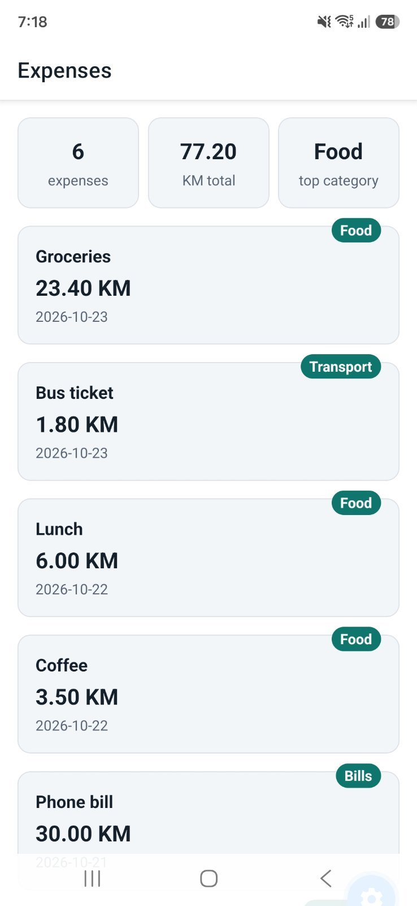
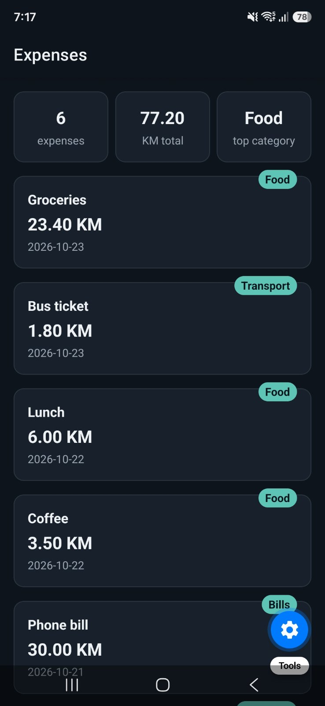

# Cache

Cache is an app for keeping track of your spending. Write down what you paid for, how much it cost and when. You can also add a photo of the receipt. At the end of the month you see where your money went, category by category.

## Screenshots

| Light mode                                 | Dark mode                                |
| ------------------------------------------ | ---------------------------------------- |
|  |  |

## Run the project

Requires Expo Go on SDK 58.

```bash
npm install
npx expo start
```

## Features

- [x] See your expenses in a list (sample data for now)
- [x] Quick totals above the list: number of expenses, total spent and top category
- [x] Light and dark mode that follows your phone's setting
- [x] Layout that fits small phones, large phones and tablets
- [x] A loading spinner, and a Try again button if loading fails
- [x] Pull the list down to refresh it
- [x] Show only one category, and sort by newest or highest amount
- [x] Long press an expense to delete it, with a confirmation first (not saved yet)
- [ ] Open an expense to see all its details
- [ ] Log in and sign up with email and password
- [ ] See expenses grouped by day
- [ ] Add and edit expenses, with checks on the form
- [ ] Attach a receipt photo from the camera or gallery
- [ ] See a monthly summary by category
- [ ] Three tabs: Expenses, Summary and Profile
- [ ] Save expenses online so they follow your account
- [ ] Pick a currency (BAM, EUR or USD)
